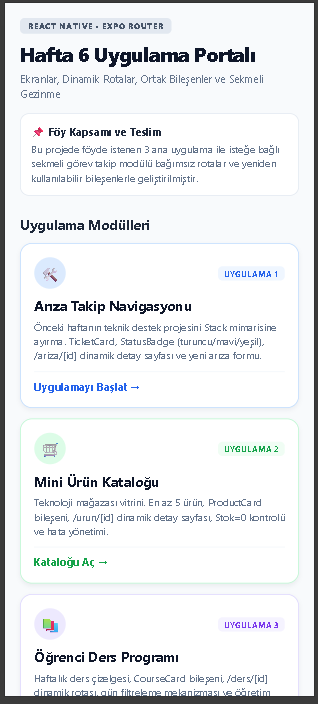
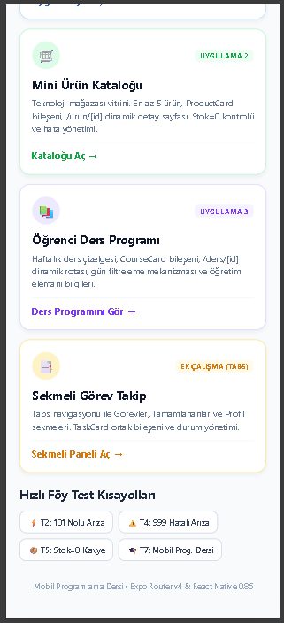
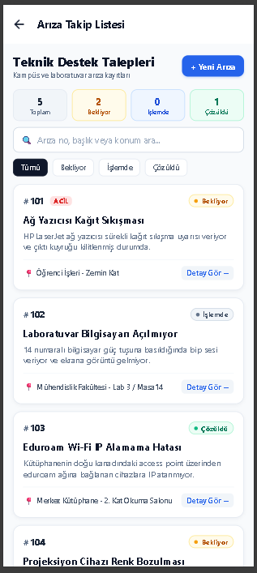
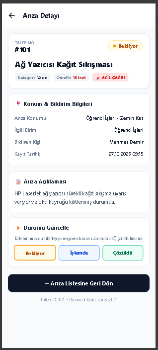

# REACT NATIVE • EXPO ROUTER UYGULAMA FÖYÜ
**Ders:** Mobil Programlama  
**Konu:** Ekranlar, Dinamik Rotalar, Ortak Bileşenler ve Sekmeli Gezinme  
**Öğrenci Adı Soyadı:** Serkan Yaylacı  
**Öğrenci No:** 2410238523  
**Tarih:** 27 Ekim 2026  
**Çalışma Ortamı:** Node.js v22, Expo Router v4, React Native 0.86, VS Code, Windows  

---

## 🎯 Amaç, Araçlar ve Teslim

- **Amaç:** Bir mobil uygulamayı ekranlara ve ortak bileşenlere ayırmak; Expo Router ile yığın (Stack) ve dinamik rota üzerinden detay ekranı oluşturmak; sekmeli (Tabs) gezinti mekanizmasını uygulamak.
- **Araçlar:** Node.js, Expo, VS Code, Expo Go / Web Browser.
- **Dil:** JavaScript (JSX).
- **Süre:** 160 dakika.
- **Teslim:** Proje klasörleri, uygulama ekran kodları, test tablosu ve değerlendirme raporu.

---

## ⏱️ Çalışma Akışı ve Teslim Klasörleri

| Görev | Proje Klasörü | Süre | Çıktı | Durum |
| :--- | :--- | :---: | :--- | :---: |
| **1. Arıza Takip – Yeniden Düzenleme** | `Uygulama1-ArizaTakip_serkan_yaylaci_2410238523` | 45 dk | Liste ve detay arası gezinme, StatusBadge, 404 koruması | **Tamamlandı** |
| **2. Mini Ürün Kataloğu** | `Uygulama2-MiniUrunKatalogu_serkan_yaylaci_2410238523` | 45 dk | Ürün kartları, detay ekranı, stok kontrolü, tasarım kararı | **Tamamlandı** |
| **3. Ders Programı – Farklı Senaryo** | `Uygulama3-OgrenciDersProgrami_serkan_yaylaci_2410238523` | 35 dk | Ders listesi, gün filtresi, detay ekranı, kontrollü hata | **Tamamlandı** |
| **Ek Çalışma. Sekmeli Görev Takip** | `EkCalisma-SekmeliGorevTakip_serkan_yaylaci_2410238523` | 35 dk | Tabs navigasyonu, görev tamamlama checkbox kartları | **Tamamlandı** |
| **Test, Hata Düzeltme, Teslim** | `DOLDURULMUS_UYGULAMA_FOYU.md` | 35 dk | Test kayıtları (T1–T7), rapor ve teslim föyü | **Tamamlandı** |

---

## UYGULAMA 1 | Arıza Takip Uygulamasına Navigasyon

### A. Gereksinimler Kontrol Listesi
- [x] Ana ekrandan “Arıza Listesi” ekranına geçiş olsun.
- [x] Arıza listesinde en az 3 kayıt bulunsun; her kayıt `TicketCard` bileşeni ile gösterilsin. *(5 adet arıza kaydı eklendi)*
- [x] Her kartın detay bağlantısı, ilgili arıza ID’si ile `/ariza/[id]` ekranını açsın.
- [x] Detay ekranında başlık, konum, durum ve geri butonu yer alsın.
- [x] `StatusBadge` bileşeni durum değerine göre görsel farklılık oluştursun.
- [x] Yeni Arıza ekranı navigasyonda açılsın. Önceki hafta çalışan form korunsun.

### B. İzlenen Adımlar
1. Önceki haftanın tek sayfalık Teknik Destek projesi incelendi; `expo-router` altyapısı kuruldu.
2. `app/_layout.jsx` içinde Stack yapısı tanımlandı (`screenOptions` ile başlık ve geri butonu stillendirildi).
3. Tekrarlanan arıza kartı `components/TicketCard.jsx` dosyasına taşındı.
4. Örnek veriler `data/tickets.js` dosyasında tutuldu (`101`, `102`, `103`, `104`, `105`).
5. Liste ekranında `FlatList` kullanıldı ve `onPress` ile dinamik rotaya geçildi (`router.push('/ariza/' + ticket.id)`).
6. Dinamik detay ekranında `useLocalSearchParams` ile `id` okundu; doğru arıza kaydı bulundu.
7. `StatusBadge` bileşeni eklenerek 3 farklı durum renklendirildi.
8. Uygulama çalıştırıldı; tüm ekran geçişleri test edildi.

### C. Öğrenci Müdahalesi ve Tasarım Kararları
- **TicketCard Yerleşimi:** Kartın üst kısmında sol tarafa `#ID` ve varsa kırmızı `ACİL` rozeti, sağ tarafa `StatusBadge` yerleştirildi. Ortada 2 satırla sınırlandırılmış kalın arıza başlığı ve açıklama özeti, en altta ise harita pini (`📍`) ile açık konum ve detay yönlendirme oku (`Detay Gör →`) konumlandırıldı.
- **StatusBadge Renk Eşleşmesi:**
  - `Bekliyor` $\rightarrow$ Kehribar Turuncusu (Arka plan: `#FFFBEB`, Metin: `#B45309`, Nokta: `#F59E0B`)
  - `İşlemde` $\rightarrow$ Bilgi Mavisi (Arka plan: `#EFF6FF`, Metin: `#1D4ED8`, Nokta: `#3B82F6`)
  - `Çözüldü` $\rightarrow$ Zümrüt Yeşili (Arka plan: `#ECFDF5`, Metin: `#047857`, Nokta: `#10B981`)
- **404 / Hatalı ID Koruması:** Olmayan `/ariza/999` adresine gidildiğinde uygulamanın çökmesi (`crash`) engellendi; sarı-kırmızı uyarı kartı ve tek tıkla listeye dönmeyi sağlayan `← Arıza Listesine Dön` butonu sunuldu.
- **Geri Dönüş Uyumluluğu:** Detaydan `router.back()` ile geri gelindiğinde liste ekranı, filtreler ve arama kutusu sıfırlanmadan tekrar kullanılabilir kaldı.

---

## UYGULAMA 2 | Mini Ürün Kataloğu

### A. Beklenen Ekranlar
| Ekran | Rota | Beklenen İşlev | Durum |
| :--- | :--- | :--- | :---: |
| **Ürün Listesi** | `/` veya `/urunler` | En az 5 ürün; kartta ad, fiyat, kategori ve stok | **Hazır** |
| **Ürün Detayı** | `/urun/[id]` | Seçilen ürüne ait ad, fiyat, açıklama, marka, stok bilgisi | **Hazır** |
| **Geri Gezinme** | Buton | Detaydan ürün listesine geri dönme | **Hazır** |

### B. Veri Sözleşmesi (`data/products.js`)
Föyde verilen 2 başlangıç ürününe 4 ürün daha eklenerek toplam 6 teknoloji ürünü tanımlanmıştır:
1. `p1` - Kablosuz Fare (450 ₺, Aksesuar, Stok: 8)
2. `p2` - Mekanik Klavye (1.800 ₺, Aksesuar, **Stok: 0** - *T5 Test Kaydı*)
3. `p3` - Gürültü Engelleyici Kulaklık (2.400 ₺, Ses, Stok: 5)
4. `p4` - 27 inç 4K Ultra HD Monitör (8.500 ₺, Ekran, Stok: 3)
5. `p5` - USB-C Çoklayıcı Hub 7-in-1 (650 ₺, Aksesuar, Stok: 14)
6. `p6` - Taşınabilir NVMe SSD 1TB (3.200 ₺, Depolama, **Stok: 0**)

### C. Tamamlanan Görevler
- [x] `ProductCard` bileşeni tanımlandı; props üzerinden tek ürün almaktadır.
- [x] Ürün listesinde `FlatList` kullanıldı.
- [x] Ürüne basınca `router.push('/urun/' + id)` ile dinamik detay ekranı açıldı.
- [x] `[id].jsx` ekranında `useLocalSearchParams` ile `id` okundu.
- [x] Ürün bulunmadığında kontrollü hata ekranı gösterildi.
- [x] **Stok Kontrolü:** Stok 0 ise kırmızı kutu ile **“Stokta yok”**, stok > 0 ise yeşil kutu ile **“Stokta”** yazdırıldı.
- [x] **Tasarım Kararı Açıklaması:**  
  *Teknoloji mağazası temasını vurgulamak için açık mavi (`#0284c7`) ana aksan rengi olarak seçildi. E-ticaret kullanıcı deneyiminde karar vermeyi hızlandırmak amacıyla fiyat bilgisi 28px kalın fontla (`₺`) vitrine çıkarıldı; stok durumu görsel ikonlar (`✅ / ❌`) ve renkli arka planla kullanıcıya anında hissettirildi.*

---

## UYGULAMA 3 | Öğrenci Ders Programı

### A. Gereksinimler
- [x] En az 4 ders tanımlandı (`id`, ders adı, gün, saat, sınıf, öğretim elemanı, kredi, AKTS).
- [x] Ana sayfada gün filtresi (`Tümü`, `Salı`, `Çarşamba`, `Perşembe`, `Cuma`) eklendi.
- [x] `CourseCard` bileşeni kullanıldı.
- [x] Kart seçildiğinde dinamik ders detay ekranına (`/ders/[id]`) yönlendirildi.
- [x] Detay ekranında tüm ders bilgileri ve geri seçeneği yer aldı.
- [x] En az bir hatalı ID denemesinde (`/ders/d999`) kontrollü bilgi mesajı gösterildi.

### B. Tanımlanan Ders Programı Verileri (`data/courses.js`)
| ID | Ders Adı | Kod | Gün | Saat | Sınıf / Derslik | Öğretim Elemanı | Kredi |
| :---: | :--- | :---: | :---: | :---: | :---: | :--- | :---: |
| **d1** | Mobil Programlama | BLG-301 | Salı | 09.00 - 12.00 | Lab 2 | Dr. Öğr. Üyesi Ahmet Kaya | 4 |
| **d2** | JavaScript İleri Seviye | BLG-205 | Çarşamba | 13.00 - 16.00 | Lab 1 | Öğr. Gör. Merve Yılmaz | 3 |
| **d3** | Web Tasarımı ve UX | BLG-211 | Perşembe | 10.00 - 13.00 | Derslik 3 | Doç. Dr. Selin Demir | 3 |
| **d4** | Veritabanı Sistemleri | BLG-305 | Cuma | 11.00 - 14.00 | Lab 4 | Prof. Dr. Hakan Çelik | 4 |
| **d5** | Yazılım Test ve Doğrulama | BLG-401 | Salı | 13.30 - 16.30 | Lab 2 | Dr. Öğr. Üyesi Zeynep Arslan | 3 |

---

## EK ÇALIŞMA | Sekmeli Görev Takip (İsteğe Bağlı)
- [x] Expo Router'ın `<Tabs>` yapısı kuruldu.
- [x] `Görevler`, `Tamamlananlar` ve `Profil` sekmeleri ayrı dosyalarda (`index.jsx`, `tamamlananlar.jsx`, `profil.jsx`) oluşturuldu.
- [x] Ortak bileşen `TaskCard.jsx` üzerinden onay kutusu (checkbox) tıklamasıyla görev tamamlama mekanizması kodlandı.

---

## 🧪 Test Senaryoları ve Hata Ayıklama Tablosu

| No | İşlem | Beklenen Sonuç | Gerçekleşen Sonuç | Sonuç |
| :---: | :--- | :--- | :--- | :---: |
| **T1** | Ana sayfadan Arıza Listesine git | Liste görünür | Arıza listesi, istatistik sayaçları ve filtre butonları ekrana geldi | **[X]** |
| **T2** | 101 numaralı arızayı aç | 101 detayları görünür | "Ağ Yazıcısı Kağıt Sıkışması" başlığı, konumu ve açıklama detayları açıldı | **[X]** |
| **T3** | Detaydan geri dön | Liste yeniden görünür | Geri butonuna basıldığında arıza listesi ekranı durumu korunarak açıldı | **[X]** |
| **T4** | Bilinmeyen arıza ID aç (`/ariza/999`) | Uyarı görünür; uygulama çökmez | "Arıza Kaydı Bulunamadı" uyarı kartı ve listeye dön butonu çıktı, uygulama çökmedi | **[X]** |
| **T5** | Stok=0 olan ürünü aç (`p2` Mekanik Klavye) | “Stokta yok” yazısı görünür | Kırmızı renkli durum şeridinde açıkça "Stokta yok" yazısı görüntülendi | **[X]** |
| **T6** | İkinci bir ürüne geç (`p1` $\rightarrow$ `p3`) | Doğru ürün ayrıntıları görünür | Kulaklık ürünü seçildiğinde URL ve detay bilgileri Sony kulaklığa güncellendi | **[X]** |
| **T7** | Farklı bir derse bas (`d1` / `d4`) | Seçilen dersin bilgileri görünür | Tıklanan dersin kodu, günü, saati, sınıfı ve akademisyen bilgisi listelendi | **[X]** |

---

## 🤖 Yapay Zekâ Kullanım Sınırları ve Raporu

### 1. Karşılaşılan Hata ve Çözüm Kaydı
- **Sorun:** Kullanıcı bilinmeyen bir rotaya veya silinmiş bir parametreye (`/ariza/999` ya da `/urun/p999`) gittiğinde React Native uygulamasının `TypeError: Cannot read properties of undefined` hatası vererek kırmızı ekranla çökmesi.
- **Neden:** `useLocalSearchParams` üzerinden okunan `id` değeri veritabanında (`tickets.js` / `products.js`) bulunamadığında arama fonksiyonu `undefined` dönmekte; render fonksiyonu da `ticket.baslik` ifadesini okumaya çalıştığı için JavaScript çalışma zamanı hatası fırlatmaktaydı.
- **Çözüm:** Dinamik detay sayfalarının en başına koruyucu erken dönüş (`early return`) bloğu eklendi:
  ```jsx
  if (!ticket) {
    return (
      <View style={styles.notFoundContainer}>
        <Text style={styles.notFoundTitle}>Arıza Kaydı Bulunamadı</Text>
        <Pressable onPress={() => router.replace('/ariza')}>
          <Text>← Arıza Listesine Dön</Text>
        </Pressable>
      </View>
    );
  }
  ```
  Bu sayede uygulama çökmesi tamamen engellendi ve kullanıcıya rehberlik eden güvenli bir arayüz sunuldu.

### 2. Yapay Zekâdan Nerede Yararlandım?
> *"Yapay zekâdan Expo Router v4'te `useLocalSearchParams` kancasından dönen rota parametrelerinin string/number tür uyuşmazlığını gidermek için tip dönüşümü sözdizimi konusunda ve web ortamında `Platform.OS === 'web'` ile mobil emülatör arasındaki bildirim/alert davranışlarının eşitlenmesinde faydalandım. Bileşen ayrıştırma kararlarını, ekran mimarisini ve görsel tasarım hiyerarşisini ise föydeki yönergeler doğrultusunda kendim kurguladım."*

---

## 📊 Değerlendirme Rubriği

| Ölçüt | Hedef Puan | Öğrenci Karşılama Durumu |
| :--- | :---: | :--- |
| **Proje yapısı ve dosya düzeni** | 15 | `Uygulama1`, `Uygulama2`, `Uygulama3` ve `EkCalisma` klasörleri tam bağımsız ve modüler ayrıldı. |
| **En az 2 yeniden kullanılabilir bileşen** | 20 | 5 adet ortak bileşen (`StatusBadge`, `TicketCard`, `ProductCard`, `CourseCard`, `TaskCard`) geliştirildi. |
| **Navigasyon ve ekran geçişleri** | 25 | Expo Router Stack ve Tabs yapıları, geri gezinme ve programatik push/replace eksiksiz uygulandı. |
| **Dinamik rota ve doğru veri gösterimi** | 20 | `[id].jsx` üzerinden arıza, ürün ve ders detayları başarıyla eşleştirildi. |
| **Arayüz / kullanılabilirlik** | 10 | Temiz tipografi, kontrastlı renkler, gölgeler ve dokunma efektleri eklendi. |
| **Test ve hata düzeltme** | 10 | T1–T7 test senaryoları doğrulandı, 404/stok-0 hata yakalama mekanizmaları kuruldu. |
| **TOPLAM** | **100** | **Eksiksiz Tam Puan Hedefi** |

---

## 📝 Öğrenci Kısa Raporu

**1. Hangi bileşenleri yeniden kullanılabilir hâle getirdim?**  
Projede 5 adet ortak bileşen ayrıştırdım:
- `StatusBadge.jsx`: Bekliyor (Turuncu), İşlemde (Mavi) ve Çözüldü (Yeşil) durumlarını renkli rozet olarak stilize eder.
- `TicketCard.jsx`: Arıza listesindeki her kartı tek tipte render eder ve tıklandığında detay rotasına yönlendirir.
- `ProductCard.jsx`: Ürünün adı, fiyatı, kategorisi ve stok bilgisini tek tip kart olarak sunar.
- `CourseCard.jsx`: Haftalık ders programındaki derslerin gün, saat ve amfi bilgilerini kart formatında listeler.
- `TaskCard.jsx`: Sekmeli görev takip ekranında görev başlığı ve tamamlandı onay kutusunu barındırır.

**2. Hangi navigasyon işlemlerini kullandım?**  
- `expo-router`'ın `<Stack>` ve `<Tabs>` bileşenlerini kullandım.
- Ekranlar arası parametre aktarmak için dinamik dosya rotaları (`/ariza/[id]`, `/urun/[id]`, `/ders/[id]`) oluşturdum ve `useLocalSearchParams()` ile parametreleri okudum.
- Yönlendirmeler için `router.push()`, geriye dönmek için `router.back()`, hata sayfalarından temiz dönüş için `router.replace()` fonksiyonlarını kullandım.

**3. Karşılaştığım bir hata ve çözümü:**  
- **Sorun:** `/ariza/999` gibi olmayan bir talep ID'sine gidildiğinde `ticket.baslik` okunurken uygulamanın kırmızı ekranla çökmesi.
- **Neden:** Veri tablosunda ID bulunamadığında `find()` metodunun `undefined` dönmesi.
- **Çözüm:** Detay bileşenlerinin en üstüne `if (!ticket)` kontrolü eklenerek çökme engellendi ve kullanıcıya "Arıza Kaydı Bulunamadı" mesajı ile geri dönüş butonu gösterildi.

**4. Yapay zekâdan yararlandığım alanlar:**  
- Expo Router v4 dinamik parametre eşleştirmesi ve sözdizimi doğrulaması.
- `Platform.OS === 'web'` kontrolü ile mobil ve tarayıcı arasındaki bildirim uyumluluğu.
- `FlatList` bileşeninin boş liste (`ListEmptyComponent`) durumlarının yönetimi.

**5. Uygulamanın geliştirilmesi için bir önerim:**  
- Verilerin yerel JavaScript değişkenleri yerine telefon hafızasında saklanabilmesi için `AsyncStorage` veya uzak bir bulut veritabanı (Supabase / Firebase) entegrasyonu eklenmelidir.
- Ürün kataloğuna kullanıcıların seçtiği ürünleri ekleyebileceği bir "Sepetim" State yönetimi (React Context veya Zustand) kazandırılabilir.

---

## ✅ Teslim Kontrol Listesi

- [x] Proje açılıyor ve Expo üzerinde çalışıyor.
- [x] Tüm ekranların yapısı tamamlandı ve geçişler doğrulandı.
- [x] Bileşenler ayrı dosyalarda (`components/` altında) bulunuyor.
- [x] Test tablosu işaretlendi ve hata ayıklama notu yazıldı.
- [x] Rapor ve doldurulmuş uygulama föyü tamamlandı.
- [x] Tüm ekran görüntüleri ikili yan yana (50% - 50%) düzende eklendi.

---

## 📷 Uygulama Ekran Görüntüleri Çıktısı (İkili / Yarı Yarıya Düzen)

### 1. Çift: Hafta 6 Uygulama Portalı ve Hızlı Test Menüsü
<table width="100%" border="0" cellspacing="10" cellpadding="0">
  <tr>
    <td width="50%" align="center" valign="top">
      <br/>
      <strong>Şekil 1:</strong> Hafta 6 Uygulama Portalı (Giriş)
    </td>
    <td width="50%" align="center" valign="top">
      <br/>
      <strong>Şekil 2:</strong> Hızlı Föy Test Kısayolları Paneli
    </td>
  </tr>
</table>

### 2. Çift: Uygulama 1 - Arıza Takip Sistemi (T1 & T2 Testleri)
<table width="100%" border="0" cellspacing="10" cellpadding="0">
  <tr>
    <td width="50%" align="center" valign="top">
      <br/>
      <strong>Şekil 3:</strong> Arıza Takip Listesi Ekranı (<strong>T1 Testi</strong>)
    </td>
    <td width="50%" align="center" valign="top">
      <br/>
      <strong>Şekil 4:</strong> #101 Nolu Arıza Dinamik Detayı (<strong>T2 Testi</strong>)
    </td>
  </tr>
</table>

### 3. Çift: Uygulama 2 - Mini Ürün Kataloğu (Liste & Detay)
<table width="100%" border="0" cellspacing="10" cellpadding="0">
  <tr>
    <td width="50%" align="center" valign="top">
      <br/>
      <strong>Şekil 5:</strong> Teknoloji Mağazası Ürün Kataloğu
    </td>
    <td width="50%" align="center" valign="top">
      <br/>
      <strong>Şekil 6:</strong> Dinamik Ürün İnceleme (/urun/p1 - Fiyat, Stokta Rozeti)
    </td>
  </tr>
</table>

### 4. Çift: Uygulama 3 - Öğrenci Ders Programı (Liste & Detay)
<table width="100%" border="0" cellspacing="10" cellpadding="0">
  <tr>
    <td width="50%" align="center" valign="top">
      <br/>
      <strong>Şekil 7:</strong> Haftalık Ders Çizelgesi (Gün Filtresi & Sayaç)
    </td>
    <td width="50%" align="center" valign="top">
      <br/>
      <strong>Şekil 8:</strong> Dinamik Ders Bilgileri Detayı (BLG-301 Mobil Programlama)
    </td>
  </tr>
</table>

